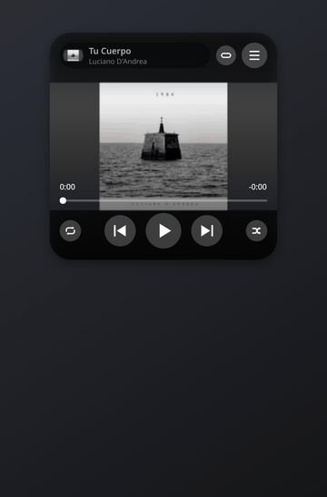
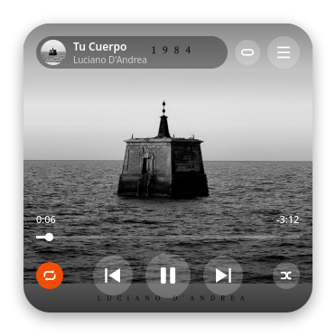
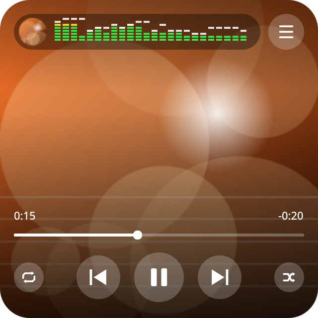
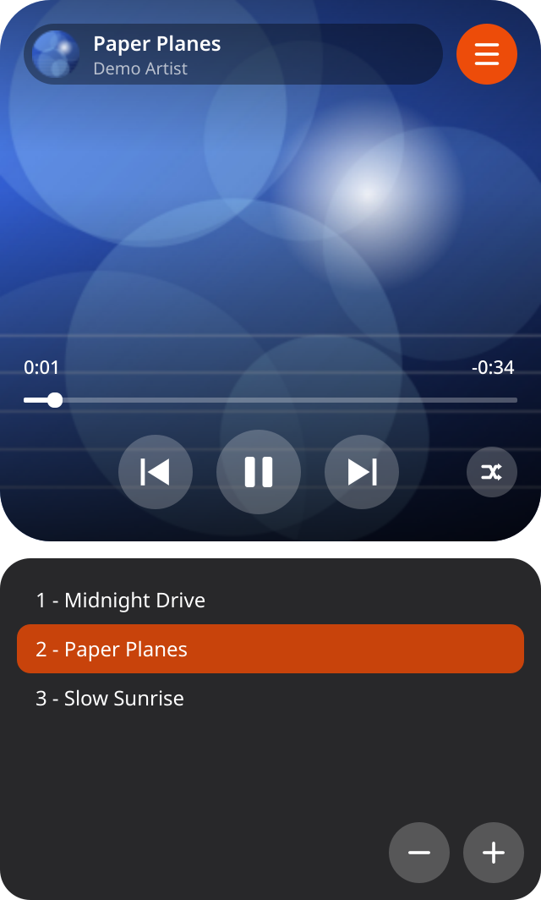

# simpleplay

A small, clean mp3 and FLAC player for Linux and Windows, for people who just want to play their own music.
No streaming, no accounts, no ads.

**Website:** https://cufadev.github.io/simpleplay/

<p align="center">
  
</p>

<p align="center">
  
  
  
</p>

<sub>Screenshots show "Tu Cuerpo" by Luciano D'Andrea.</sub>

## Features

- A single rounded card with the track's cover art. No title bar, no clutter.
- Title and artist scroll when they don't fit.
- Click the top pill to switch between the track info and **Winamp-style spectrum bars**
  that react to the real audio.
- Previous, play/pause, next, shuffle, repeat (off, the whole list, one track), and a time bar you
  can click or drag to seek.
- A playlist panel that slides open. It shows "Artist - Title" from the tags, and has a **search
  box**, **sorting** (by artist, title or album) and **drag and drop** to reorder.
- Add files or **a whole folder** (with its subfolders) from the **+** button, with a right click,
  by dragging files or folders onto the window, or from the command line. It remembers the last
  folder you used. Select several tracks with `Ctrl`/`Shift`+click and remove them with **-**.
- Remembers your last session (playlist, track, position, shuffle) and starts paused,
  ready to resume.
- Smooth transitions for play/pause, cover changes, the playlist and the buttons, and an animated morph
  between the card and the compact bar. A soft shadow lifts the window off the desktop
  (`SIMPLEPLAY_SOMBRA=0` turns it off).
- Plays through its own audio engine ([miniaudio](https://miniaud.io/)): exact position, no clicks when
  pausing or seeking, instant seeking even inside hour-long mixes, and the spectrum follows exactly what
  you hear. If the sound device disappears (a USB or Bluetooth speaker unplugged, waking from suspend) it
  reopens by itself and the track goes on where it was. Tracks that cannot be played are skipped.
- Media keys and desktop controls (MPRIS): play/pause, next and previous from your keyboard
  and from the KDE and GNOME media widgets.
- **Sound:** a volume normalizer (uses ReplayGain tags, or measures each track once) so tracks play at
  the same loudness, and an equalizer with presets (Flat, Lively, More bass, Vocals, Bright, Warm) behind a
  soft limiter. Right click > **Sound**. Flat leaves the audio untouched.
- **Two equalizers:** Right click > **Sound** > **Equalizer…** opens either a 10-band **graphic** equalizer (the presets,
  your own named presets and "Find my sound" use it) or a 5-band **parametric** one (free frequency, gain and width per
  band), with a Graphic | Parametric switch at the top. They are separate curves and only one is active at a time;
  switching tabs does not convert one into the other.
- **Headphone profiles:** pick your headphone model from the AutoEq database (or import a profile) and the equalizer
  corrects its frequency response. Right click > **Sound** > **Headphones**.
- **Playlists:** save and open plain M3U8 files (VLC and mpv read them too), with paths relative to the list so it
  survives moving the music. Right click tracks > **Add to playlist**, or use the floppy-disk button next to the list.
- Plays **mp3 and FLAC** (including 24-bit / 96 kHz), with tags and cover art in both.
- The overall volume is left to the system mixer.
- The interface is in English or Spanish, following your system language.

## Download

Get the AppImage from the [Releases](../../releases) page, then make it executable and run it:

```
chmod +x simpleplay-1.5.3-x86_64.AppImage
./simpleplay-1.5.3-x86_64.AppImage
```

On GNOME you can also right click the file, open **Properties > Permissions** and enable
**Allow executing file as program**.

Requirements:

- A 64-bit (x86_64) Linux desktop with glibc 2.35 or newer (Ubuntu 22.04+, Debian 12+,
  Fedora 36+, Linux Mint 21+, Arch and similar).
- `libGL` and `libEGL` (every desktop install has them).
- FUSE 2 to run AppImages directly (`libfuse2t64` on recent Ubuntu). Without it, run
  `./simpleplay-1.5.3-x86_64.AppImage --appimage-extract-and-run`.

It does not add itself to your applications menu. Use
[AppImageLauncher](https://github.com/TheAssassin/AppImageLauncher), or copy
`packaging/simpleplay.desktop` and the icon by hand.

### Windows

Download `simpleplay-<version>-windows-x64.zip` from the [Releases](../../releases) page, unzip it
and run `simpleplay.exe`. There is nothing to install. The file is not signed, so Windows
SmartScreen shows "Windows protected your PC": click **More info** > **Run anyway**. The media
keys are not available on Windows.

It is built automatically from this repository for every release (GitHub Actions), and the build
checks that the audio decoder works and that the window starts. It is new and has had little use
on real Windows machines, so it may have rough edges. To build it yourself, run
`packaging\build-windows.bat` on a Windows machine.

## Run from source

Python 3.10 to 3.13. On Linux and macOS:

```
python3 -m venv .venv
.venv/bin/pip install -r requirements.txt
.venv/bin/python simpleplay.py [file.mp3 ...]
```

On Windows (PowerShell or Command Prompt, with Python from python.org and "Add to PATH" ticked):

```
py -3.13 -m venv .venv
.venv\Scripts\pip install -r requirements.txt
.venv\Scripts\python simpleplay.py
```

Nothing else is needed: decoding and playback are both done by `miniaudio`, which talks to PulseAudio,
PipeWire or ALSA on Linux (WASAPI on Windows). There is no `ffmpeg` or SDL dependency.

## Controls

| Action | How |
|---|---|
| Play / pause | center button, `Space`, or the media key |
| Previous / next | the buttons, `P` / `N`, or the media keys |
| Seek | click or drag the time bar; `Left` / `Right` jump 5 s |
| Track info / spectrum | click the top pill |
| Compact mode | the button next to the list one, `M`, or right click; the same to go back |
| Compact mode | the button next to the list one, `M`, or right click; the same to go back |
| Playlist | the list button (inside it: search box, sort, **-** and **+**) |
| Search the list | `Ctrl+F`, type; `Enter` plays the first result, `Esc` clears the search |
| Sort the list | the sort button in the playlist: by artist, title, album, or the order added |
| Reorder tracks | drag them in the playlist (not while a search is active) |
| Repeat | the button at the left of the controls, or `R`: off > whole list > one track |
| Open files or a folder | **+**, `Ctrl+O` (files), `Ctrl+Shift+O` (folder), right click, drag and drop, or command line |
| Select several tracks | `Ctrl`+click or `Shift`+click in the list |
| Remove the selected tracks | the **-** button or `Delete` (the files are not deleted) |
| Move the window | drag any empty area |
| Quit | `Esc` (when no search is active), or right click > Close |

## Troubleshooting

No sound, or the spectrum bars stay flat? Check the decoding and the sound device without opening
the window:

```
./simpleplay-1.5.3-x86_64.AppImage --diagnose some-song.mp3
```

(or `python simpleplay.py --diagnose some-song.mp3` from source). To see what the player is
doing while it runs, start it with `SIMPLEPLAY_DEBUG=1` from a terminal and include the
output when reporting a problem.

## Clean up your library from the command line

Files downloaded from YouTube usually have no tags and names like
`Gustavo Cerati - Pulsar (Official Video) [FCdOGM-Ac-8].mp3`. `tools/limpiar_biblioteca.py` takes the
artist and the title out of the name (or out of the tags that already exist), dropping `(Official
Video)`, `[id]`, `- Topic`, and writes them into the files. It does not need the player to be running.

```
python tools/limpiar_biblioteca.py ~/Music                  # only shows what it would change
python tools/limpiar_biblioteca.py ~/Music --aplicar        # writes the clean title and artist
python tools/limpiar_biblioteca.py ~/Music --musicbrainz    # also looks up album, year and cover art
python tools/limpiar_biblioteca.py --deshacer               # puts the last run back as it was
```

- By default it **changes nothing**: it prints one line per file and a summary.
- When it writes, the previous tags and cover are saved first and files go through a temporary
  copy, so `--deshacer` restores them exactly. File names are never touched.
- Names without an artist (`Black [id]`) are reported as having no data; they cannot be guessed.
- `--musicbrainz` needs internet and takes around 6 seconds per file. It only accepts a clearly
  matching official studio album, whose length is close to the file's. Its results are still
  being tuned: look at the dry run before using `--aplicar`.

## Turn videos into audio

`tools/convertir.sh` converts the audio of every video in a folder (and its subfolders) to mp3 or FLAC. It needs
`ffmpeg` (with no folder it uses the current one), keeps the folder structure and the tags, never overwrites what is already converted, and leaves the
originals alone.

```
tools/convertir.sh                                      # the folder you are in
tools/convertir.sh ~/Videos/concerts                    # mp3, best variable quality, into ~/Videos/concerts/audio-convertido
tools/convertir.sh ~/Videos/concerts -q 320             # constant 320 kbps
tools/convertir.sh ~/Videos/concerts -f flac -o ~/Music/concerts
tools/convertir.sh ~/Videos/movies -p 1                 # the second audio track
```

## Build the AppImage

`packaging/build.sh` builds `dist/simpleplay-<version>-x86_64.AppImage` inside an
Ubuntu 22.04 container (Docker required), so it does not depend on the glibc of the
machine that builds it.

## Project files

- `simpleplay.py`: the application (PySide6 + miniaudio).
- `icon/`: app icon as SVG and PNG.
- `packaging/`: AppImage build scripts and desktop entry.
- `legacy/`: the first, minimal Tkinter version.
- [CHANGELOG.md](CHANGELOG.md) and [ROADMAP.md](ROADMAP.md).

## Support

simpleplay is free and always will be. If it is useful to you, you can
[buy me a beer](https://buymeacoffee.com/cufadev). It is entirely optional.

## License

simpleplay is free software, released under the
[GNU General Public License v3.0 or later](LICENSE).

Copyright (C) 2026 Facundo González <facundonic.gonzalez@gmail.com>

It uses PySide6, mutagen, numpy and miniaudio, each under its own license.
